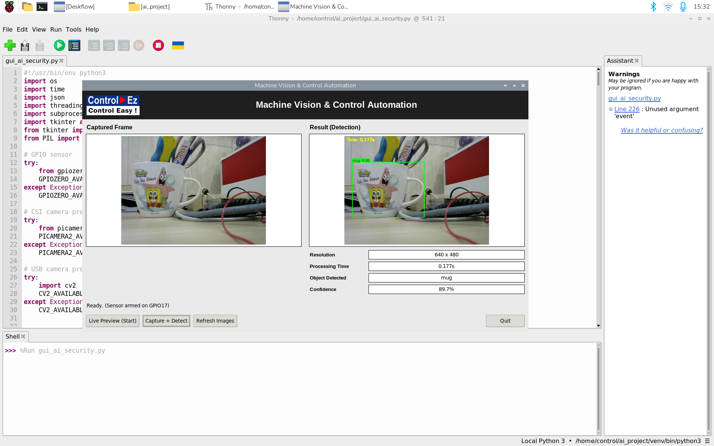

# AI Object Detection Security System

A sensor-triggered object detection system for the Raspberry Pi. When a motion or contact sensor on GPIO17 fires, the Pi captures a frame from a CSI or USB camera, runs a custom-trained YOLOv8n model through ONNX Runtime, and shows the detected objects, confidence and processing time in a desktop GUI. Built during my AI Engineering internship at Control Easy Technology (2026).



*Live run on the Raspberry Pi: the custom model detects the target object at 89.7% confidence with 0.177 s processing time on a 640×480 frame.*

## Features

- **Sensor-triggered capture.** A sensor on GPIO17 arms the system; detection runs only when it fires, which saves power and CPU compared with continuous inference.
- **Two camera paths.** CSI camera through Picamera2 (with a `libcamera` fallback) or a USB webcam through OpenCV.
- **Edge inference.** ONNX Runtime on the Pi's CPU, with letterbox preprocessing and NumPy non-maximum suppression, so no PyTorch is needed on the device.
- **Two models.** A custom YOLOv8n detector trained on project-specific data (`models/best.onnx`) and a COCO-pretrained YOLOv5n (`models/yolov5n.onnx`) for the 80 standard classes such as person and car.
- **GUI or headless.** A Tkinter GUI with live preview and capture-and-detect, or a headless mode that prints a JSON result for integration with other systems.

## How It Works

```
Sensor (GPIO17) → capture frame (CSI / USB) → letterbox 640×640
              → YOLO (ONNX Runtime) → confidence filter + NMS → boxes, labels, timing → GUI / JSON
```

## Project Structure

```
ai-object-detection-security/
├── src/
│   ├── gui_ai_security.py   # Tkinter GUI: live preview, sensor trigger, capture + detect
│   ├── ai_security.py       # Inference engine (CLI), called by the GUI
│   └── custom_classes.txt   # Class names for the custom model
├── models/                  # best.onnx (custom YOLOv8n), yolov5n.onnx (COCO)
├── dataset_sample/          # Sample training images
├── demo/                    # Screenshots
└── docs/                    # How it works, setup and wiring notes
```

## Hardware

- Raspberry Pi with Raspberry Pi OS (64-bit)
- CSI camera module or USB webcam
- Motion or contact sensor connected to GPIO17 (BCM), read with an internal pull-up

## Installation

```bash
pip install -r requirements.txt
# For the CSI camera, install Picamera2 through apt:
sudo apt install python3-picamera2
```

## Run

The GUI looks for `best.onnx` and `custom_classes.txt` in `src/`. Copy the model there (or edit `MODEL_PATH` at the top of `gui_ai_security.py`), set `CAMERA_MODE` to `"usb"` or `"csi"`, then:

```bash
python3 src/gui_ai_security.py
```

Headless single detection from the command line:

```bash
python3 src/ai_security.py --model models/best.onnx --class-names src/custom_classes.txt \
    --camera usb --no-wait --headless --json
```

Use `--class-names default` with `models/yolov5n.onnx` for the COCO classes.
